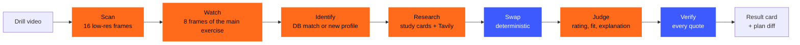

# Hangtime

**Saw a jump drill on TikTok? Check it before you train it.**

Hangtime is a training partner for athletes who want to jump higher. Upload a drill video and it answers three questions:

1. **Is it any good?** An evidence rating (well supported · partly supported · unsupported · myth) backed by curated studies. Every quote is verified word for word against its source.
2. **Is it for you?** Matched to the athlete's goal, training age, injuries and equipment.
3. **Where does it go?** A concrete swap in the next session of the athlete's plan, with the volume converted, shown as a plan diff. One tap applies it.

**Live demo:** https://hangtime-88yw.onrender.com/demo · **The story:** https://hangtime-88yw.onrender.com/about · **Demo video:** _link follows_

Built for the [Nebius x NVIDIA Global AI Hackathon](https://nebiusglobalaihackathon.devpost.com/), track **Best Apps & Agents**.

> The demo runs on a free server. The first request after a break wakes it up (about a minute); an analysis then takes 20–60 seconds.

---

## How it works



Orange steps call NVIDIA Nemotron models on Nebius Token Factory; blue steps are plain, unit-tested Python.

| Step | What happens | Runs on |
|---|---|---|
| Scan | Videos over 20 s: 16 low-res frames in two calls find every exercise and all on-screen text (the promise often sits in the intro) | `MODEL_VISION` |
| Watch | 8 full-res frames from the window of the main exercise: movement, equipment, execution | `MODEL_VISION` |
| Identify | Match to the 82-exercise database, or profile an unknown exercise on the fly | `MODEL_FAST` (`MODEL_REASON` for new profiles) |
| Research | Pick the fitting study cards; with fewer than two, search PubMed and journals with Tavily | `MODEL_FAST` + Tavily |
| Swap | Hard filters, weighted similarity, volume conversion. No model involved | Python |
| Judge | Rating, personal fit, explanation of the given swap, safety notes | `MODEL_REASON` (thinking on) |
| Verify | Every quote must appear verbatim in the source it cites, or it is removed. No valid quote left → "unsupported" | Python |

### Design principles

- **The model understands, the algorithm decides.** Nemotron reads the video and explains. Changing someone's plan is done by deterministic code with unit tests: same input, same swap.
- **No quote without proof.** Models invent citations; Hangtime drops any quote it cannot find in the study card or search result it claims to come from.
- **Direct vs. indirect evidence.** Injury-prevention or tendon studies can back a long-term benefit, never a promise like "+10 cm in 4 weeks". Every study card carries that label.
- **Fair to creators.** Results in videos can be real. Hangtime says what a drill is good for and what it can realistically do on its own, instead of calling a video a lie.
- **Structured output everywhere.** Every model call uses `response_format: json_schema` derived from the Pydantic models in `app/models.py`, is validated, and retried once on a validation error.

### The swap

Before scoring, hard filters drop exercises the athlete lacks the equipment, training age or health for. Each exercise in the next session is then scored against the new one:

| Feature | Weight |
|---|---|
| Force-velocity zone (max strength → reactive) | 30 % |
| Movement pattern (same pattern or family) | 25 % |
| Stretch-shortening cycle | 15 % |
| Laterality | 10 % |
| Contraction emphasis | 10 % |
| Load (fatigue, joint stress) | 10 % |

The best match at 60 % or more is replaced (on a tie, the more demanding one). Sets stay the same; reps are converted on equal ground contacts for jumps and equal fatigue for strength work, capped to the new exercise's rep range. Code: `app/pipeline/swap.py`, tests: `tests/test_swap.py`.

---

## How we use NVIDIA Nemotron, Nebius Token Factory and Tavily

**Nebius Token Factory.** Every model call in every analysis is a live call to Token Factory's OpenAI-compatible API (`https://api.tokenfactory.nebius.com/v1/`) through the `openai` SDK. One client and one retry policy live in `app/llm.py`.

**NVIDIA Nemotron.** All model calls use Nemotron, in three roles (IDs only in `app/config.py`, set via env):

| Role | Model | Used for |
|---|---|---|
| `MODEL_VISION` | `nvidia/Nemotron-3.5-Super-VL` | Scan and watch the video frames, read on-screen text. Max. 8 images per call, hence the two-pass video pipeline |
| `MODEL_FAST` | `nvidia/Nemotron-3_5-Lightning` | Claim extraction, exercise matching, study-card selection (thinking off: an 8× speed-up for extraction steps) |
| `MODEL_REASON` | `nvidia/Nemotron-3-Ultra-550b-a55b` | The verdict (thinking on) and profiles for exercises not in the database |

**Tavily.** When fewer than two curated study cards fit an exercise, `app/tavily_client.py` searches PubMed, NCBI, LWW and Springer at runtime. Results are passed to the verdict as uncurated web sources, go through the same quote check, and are labelled "web source, not curated" in the UI.

**Hosting.** The app runs as a Docker web service on Render's free tier (`render.yaml`). A runbook for Nebius Serverless Endpoints is in `docs/DEPLOY-nebius-cloud.md`.

---

## Run it locally

Requirements: Python 3.12, [uv](https://docs.astral.sh/uv/), `ffmpeg` and `ffprobe` on the PATH, a Nebius Token Factory API key, a Tavily API key.

```bash
git clone https://github.com/iblametitus/hangtime.git
cd hangtime
uv sync
cp .env.example .env          # add NEBIUS_API_KEY and TAVILY_API_KEY
uv run python scripts/check_models.py   # optional: checks the Nemotron IDs against your account
uv run uvicorn app.main:app --reload
```

Open http://localhost:8000/demo, pick an athlete and upload a drill video (mp4, mov or webm, up to 3 minutes).

Without the web UI:

```bash
uv run python -m app.pipeline.run_cli path/to/video.mp4 --caption "optional post caption"
```

With Docker:

```bash
docker build -t hangtime .
docker run -p 8000:8000 --env-file .env hangtime
```

Deploy your own copy on Render: [render.yaml](render.yaml) is a Blueprint; see `docs/DEPLOY.md`.

### Tests

```bash
uv run pytest
```

57 tests: swap algorithm (filters, similarity, volume, tie-break, determinism), citation check, evidence selection, video frame extraction, demo athletes, web flow. Model calls are mocked; the ffmpeg tests skip when ffmpeg is missing.

---

## Project structure

```
app/
  main.py, web.py      FastAPI app, pages and HTMX partials
  jobs.py, plans.py    running analyses and per-session plans (in memory)
  demo.py              three demo athletes with their plans
  models.py            all Pydantic schemas (also the JSON schemas for the models)
  llm.py               Token Factory client, structured calls, retry
  tavily_client.py     research search
  pipeline/            scan, video, understand, exercise, evidence, swap, verdict, citations, run
  templates/           Jinja2 + HTMX + Tailwind
data/
  exercises.json       82 exercise profiles
  evidence_cards/      39 study cards (own summaries + citation, no PDFs)
docs/                  SPEC, PLAN and deployment notes (partly German)
```

## Limits

- Study cards and exercise profiles were drafted with Nemotron from the original papers and are being checked by hand; the `reviewed` flag in each file shows the status.
- Focused on jumping and athletic performance. Hangtime is not medical advice.
- The demo uses three prepared athletes. Your own profile, and a training plan read from a photo, are next.
- Sessions live in memory: a server restart resets applied swaps.
- The photos on the site (`app/static/img/`) are AI-generated with Google Gemini, not real athletes.

## License

[MIT](LICENSE)
